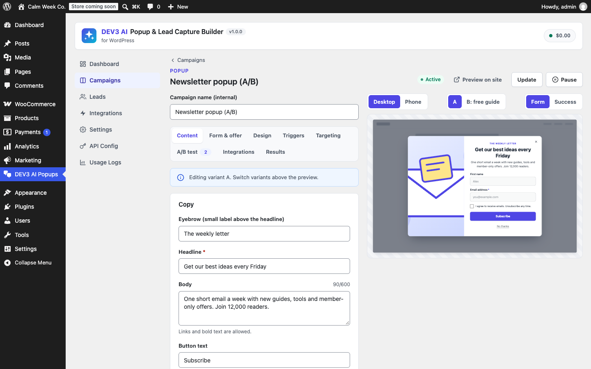

# DEV3 AI Popup & Lead Capture Builder for WordPress

Popups, slide-ins, floating bars, full-screen mats and inline forms with smart triggers, targeting, A/B tests, lead storage and DEV3 AI copywriting.



## Features

Build lead capture campaigns that convert without annoying visitors or hurting Core Web Vitals.

**Formats**: centered popups, corner slide-ins, floating top/bottom bars, full-screen welcome mats and inline forms (block, shortcode or automatic after posts). 12 templates and a visual editor with a live desktop/phone preview.

**Triggers**: exit intent (fast scroll-up on phones), scroll depth, time on page, click (any link, class or CSS selector, plus a "Popup button" block), inactivity and page load.

**Targeting**: pages, post types, categories, URLs and WooCommerce pages (checked on the server, cache-safe); devices; referrer (search, social, direct or custom); UTM tags; logged-in state; new vs returning visitors; pages viewed; WooCommerce cart value; schedule; frequency caps (once per visit, every N days, max N times, never after sign-up).

**A/B tests**: up to 4 variants with traffic weights, sticky assignment, views/leads/conversion per variant, uplift and statistical confidence, one-click "Declare winner".

**Leads**: stored in WordPress with consent proof, UTM and page data; search, filters, CSV export; Mailchimp, Brevo and signed webhooks (Zapier, Make, n8n); retry on failure; GDPR export/erase; retention; unique one-time WooCommerce coupons.

**Respectful by default**: mobile-safe mode turns popups into non-blocking bottom sheets on phones (Google intrusive interstitials guidance); one overlay per page view; focus trap, Escape, aria-modal and reduced motion; no layout shift (overlays never push content, inline forms are server-rendered) and a ~10 KB deferred script that only loads where a campaign can show.

**DEV3 AI** (Google AI, your own key): writes copy, proposes offer variants for A/B tests, suggests triggers and targeting, explains test results and drafts whole campaigns from one sentence. Every result is a draft you accept, edit or reject. AI never publishes anything.

## Requirements

- WordPress 6.0 or newer (tested up to 6.8)
- PHP 7.4 or newer
- Optional: your own Google AI API key (from Google AI Studio) to switch on the DEV3 AI features. The rest of the plugin works without one.

## Installation

### From the release zip

1. Download `dev3-ai-popup-builder.zip` from the [latest release](https://github.com/dev3tech/dev3-ai-popup-builder/releases/latest).
2. In WordPress, go to **Plugins → Add New → Upload Plugin**, choose the zip and click **Install Now**.
3. Click **Activate**.

### Build from source

```bash
git clone https://github.com/dev3tech/dev3-ai-popup-builder.git
cd dev3-ai-popup-builder
composer install --no-dev
npm ci
npm run build
```

Then copy the `dev3-ai-popup-builder` folder into `wp-content/plugins/` and activate it.

### Getting started

1. Upload the plugin zip in Plugins → Add New → Upload Plugin and activate it.
2. Open **DEV3 AI Popups** → Campaigns → New campaign and pick a template.
3. Edit the content, design, triggers and targeting, then click **Publish**.
4. Optional: add a Google AI API key under **API Config** for the DEV3 AI features, and Mailchimp/Brevo keys under **Integrations**.

## FAQ

### Does it work with page caching?
Yes. Page rules are evaluated per URL on the server; visitor rules (device, referrer, UTM, login, cart, frequency) run in the browser. Public endpoints need no nonce.

### Will it hurt my Core Web Vitals?
No markup is printed for overlays until a trigger fires, the script is deferred and idle-loaded, overlays are fixed-position (no CLS) and the stylesheet does not block rendering on pages with only overlays.

### Do I need an AI key?
No. Templates, the editor, triggers, targeting, A/B tests, leads and integrations all work without one.

### Is WooCommerce required?
No. With WooCommerce you also get cart-value targeting and unique coupons.

## Documentation

The full HTML guide (installation, settings, hooks and FAQ) is in [`docs/index.html`](docs/index.html). Open it in a browser after cloning or downloading the repository.

## Changelog

### 1.0.0
* Initial release.

## Licence

Released under the GNU General Public License v2.0 or later (GPL-2.0-or-later). See [LICENSE](LICENSE).

## More from DEV3

- [DEV3 AI Popup & Lead Capture Builder for WordPress on the DEV3 Marketplace](https://www.dev3.tech/item/dev3-ai-popup-builder)
- [More WordPress plugins, themes and templates from DEV3](https://www.dev3.tech/marketplace)
